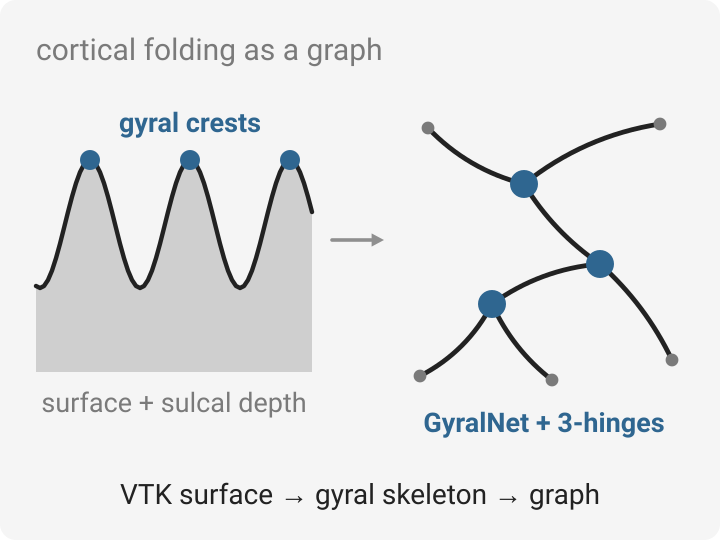

# DensityMap-GyralNet

<p align="center">
  <picture>
    <source media="(prefers-color-scheme: dark)" srcset="docs/overview-dark.svg">
    
  </picture>
</p>

Extracts the **gyral net** from cortical surfaces: the network of gyral crests whose three-way
junctions are **3-hinge gyri** (3HGs), a fine-scale cortical folding landmark. The pipeline reads
VTK surface meshes together with sulcal depth, isolates the gyral regions, skeletonizes them along
shortest paths, repairs missing crest links and marks the 3-hinge vertices. It was run on Human
Connectome Project surfaces resampled to the 32k mesh.

## What's in the repository

| Path | Purpose |
|---|---|
| `gyralnet.py`, `gyralnet_test2.py` | Gyral-net extraction for a range of subjects (skeleton, missing-crest repair, 3-hinge detection) |
| `GDM_Net/` | Gradient-density-map variant of the pipeline and its utilities (`utils/`: skeleton processing, VTK I/O, drawing, trees) |
| `20240707_prepare_hcp_surface.py`, `20240608_prepare_hcp_fmri.py` | HCP surface and fMRI preparation |
| `32k_gradient_generate.py` | Gradient features on the 32k mesh |
| `draw_3h_sphere_single_vtk.py` | Draw 3-hinge points on a sphere / surface VTK |
| `sbatch_*.py`, `3h_generate_zl.sh` | Batch submission on a Slurm cluster |

## Run

```bash
pip install vtk nibabel numpy networkx
python3 gyralnet.py --root_dir="$PWD" --subject_list_start_id=<id> --subject_list_end_id=<id+1> \
    --input_dir="<id>_recon" --out_dir=gyralnet_island_32k_flip
```

## Related work on gyral folding

- C. Cao\*, T. Chen\*, N. Zhao\*, et al. *Gyral-Sulcal-Net: An Integrated Network Representation of Brain
  Folding Patterns.* IEEE ISBI 2026. [arXiv:2601.08818](https://arxiv.org/abs/2601.08818)
- C. Cao\*, J. Cheng\*, et al. *Deep-GyralNet: Enabling Machine Learning in Gyral Folding Pattern Extraction
  on Cortical Surface.* IEEE ISBI 2026. [doi:10.1109/ISBI61048.2026.11515596](https://doi.org/10.1109/ISBI61048.2026.11515596)
- C. Cao, X. Yu, L. Zhang, et al. *Enhancing Group-Wise Consistency in 3-Hinge Gyrus Matching via Anatomical
  Embedding and Structural Connectivity Optimization.* IEEE ISBI 2024. [doi:10.1109/ISBI56570.2024.10635893](https://doi.org/10.1109/ISBI56570.2024.10635893)

All papers, with figures and summaries: [ccao2679.com/publications](https://www.ccao2679.com/publications/)

---

## 中文说明（原始笔记）

`tmp.py` 是一个处理大脑皮层表面数据的脚本，包含了多个功能模块。下面是对其主要功能和结构的概述：

### 主要功能

1. **读取和解析VTK文件**: 
    - `read_vtk_file(vtk_file)`: 读取VTK格式的文件并解析成VTK PolyData对象。
  
2. **获取点的连接信息**: 
    - `get_connect_points(surf_polydata)`: 获取每个点的邻居点。
    - `get_connect_points_gyri_part(surf_polydata, sulc_data)`: 获取指定皮层沟数据中的点的连接信息。
  
3. **孤立点处理**:
    - `delete_isolated_point(point_num, point_neighbor_points_dict, sulc_data)`: 删除皮层数据中孤立的点。

4. **边缘点查找**:
    - `find_marginal_point(points_list, point_neighbor_points_dict, sulc_data)`: 查找边缘点以及其在沟和凸起部分的位置。

5. **导出特征化的球面文件**:
    - `featured_sphere(orig_sphere_polydata, feature_file_dict, output)`： 根据特征数据导出特征化的球面文件。
  
6. **骨架树创建和连接**:
    - `create_tree(orig_sphere_polydata, orig_surf_polydata, point_patchSize_dict_updated, point_connect_points_dict_thin_gyri_parts, thin_sulc_data, output_prefix)`: 创建骨架树。
    - `find_skelenton(orig_sphere_polydata, orig_surf_polydata, point_patchSize_dict_updated, curv_data_delete_thicknessZero, original_sulc_data, thin_sulc_data, point_neighbor_points_dict, point_connect_points_dict_thin_gyri_parts, connected_lines_list, father_dict, length_thres_of_long_gyri, neighbor_missing_path_smallest_step, flat_threshold_for_convex_gyri, nearest_skeleton_num, island_gyri_length_thres, output_prefix)`: 通过创建并连接骨架树来查找骨架。

7. **寻找缺失的脑回连接并进行补全**:
    - `find_skelenton_missing(orig_sphere_polydata, orig_surf_polydata, skeleton_polydata, curv_data_delete_thicknessZero, original_sulc_data, length_thres_of_long_gyri, neighbor_missing_path_smallest_step, flat_threshold_for_convex_gyri, nearest_skeleton_num, island_gyri_length_thres, output_prefix)`: 找到缺失的脑回并补全骨架。

8. **其他工具函数**:
    - `draw_3hinge_on_surf(surf_polydata, hinge3_list, output_3hinge_vertex)`: 在表面上绘制3-hinge点。
    - `create_shortest_path(adj, start, end)`: 利用Dijkstra算法创建最短路径。
    - `main(args)`: 脚本的主函数，负责调用上述方法执行具体的功能。

### 总结

- **依赖库**： 包括 `vtk`, `nibabel`, `numpy`, `networkx`, `argparse` 等。
- **数据处理**： 脚本主要是读取、处理脑的3D结构数据，并进行骨架化处理。
- **功能模块**： 脚本清晰地将各个功能模块分开，使得每个函数只负责特定的任务。

---

```python
python3 ./gyralnet_test2.py
```


### RAW
```python
python3 /home/lab/Documents/HCP_data_32k_flip/gyralnet.py --root_dir="$PWD" --subject_list_start_id="$subject_id" --subject_list_end_id="$((subject_id + 1))" --input_dir="${subject_id}_recon" --out_dir='gyralnet_island_32k_flip'
```


---
### 20240608_prepare_hcp_fmri.py

vtk + fmri utils


---
DGM_0.7

```python
python3 GDM_0.7.py --root_dir=. --subject_list_start_id=100206 
```
