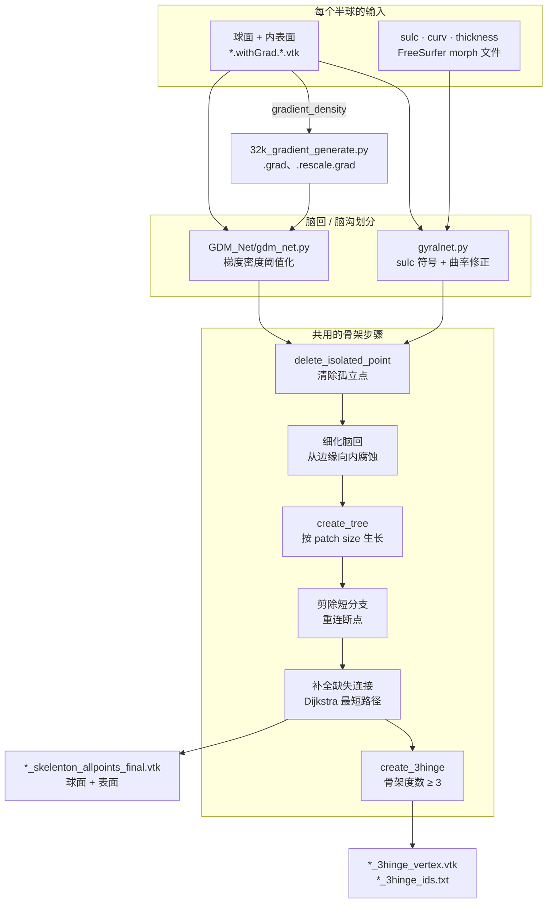

<div align="center">

# DensityMap-GyralNet

[English](README.md) · **简体中文**

**从皮层表面网格中提取脑回网络（gyral net）及其 3-hinge 脑回，可由脑沟深度或梯度密度图驱动。**


[](https://arxiv.org/abs/2601.08818)
[](https://www.ccao2679.com/research/#densitymap-gyralnet)


</div>

<!-- problem-framing:start -->

## 问题与依据

> **在相同皮层表面输入下，脑回骨架补全能否提高连接结构的一致性，同时避免添加缺乏几何依据的连接？**

**为什么值得解决：** 下游图分析依赖稳定的节点与边。骨架断裂或错误连接会改变网络结构，即使可视化效果看上去仍然合理。

**核心矛盾：** 补全断裂可以提高连通性，但也可能把原本不相邻的结构连在一起。更完整的图不一定更准确。

[完整问题与验证方案](PROBLEM.zh.md) · [English](PROBLEM.md)

<!-- problem-framing:end -->

## 亮点

- **构建什么：** *脑回网络*（gyral net），即在皮层表面上追踪出的脑回嵴线，以及其中的 **3-hinge 脑回**：三条嵴线交汇的位置，充当精细尺度上的皮层枢纽。
- **输入与输出：** 输入为 VTK 格式的表面网格和球面网格，以及逐顶点的脑沟深度、曲率与皮层厚度；输出为脑回骨架、3-hinge 顶点和图文件（VTK）。
- **为什么叫 “DensityMap”：** 除了经典的脑沟深度路线（`gyralnet.py`），`GDM_Net/` 还在 32k 网格上用梯度密度图构建同样的网络，仓库名即由此而来。
- **规模：** 每个被试运行一次，由 GNU `parallel` 分摊到各个 CPU 核（`3h_generate_zl.sh`）；用于 Human Connectome Project（HCP）表面（默认 164k fsaverage，`GDM_Net/` 使用 32k fs_LR）。Slurm 脚本负责表面预处理和梯度特征。

## 架构



从上往下看：中间两个脚本的区别在于如何把每个顶点判为脑回或脑沟（`gyralnet.py` 用经曲率修正的脑沟深度，`GDM_Net/gdm_net.py` 用阈值化的梯度密度图）；从清除孤立点开始，两者运行同一套骨架代码，`GDM_Net/utils/` 对其做了重新封装。每一步还会在最终输出旁边写出中间 VTK 文件（特征、patch size、细化后的脑回、初始树和初始骨架）。

## 工作原理

| 步骤 | 做什么 | 主要函数（`gyralnet.py`） |
|---|---|---|
| 1. 读取 | 加载表面、球面和逐顶点特征；建立顶点邻域 | `read_vtk_file`、`get_connect_points` |
| 2. 分离 | 用脑沟深度和曲率把脑回与脑沟分开，去除孤立顶点，找出边缘点 | `initialize_sulc_data`、`delete_isolated_point`、`find_marginal_point` |
| 3. 骨架化 | 从边缘向内细化每个脑回区域，从 patch 最大的顶点开始生长骨架树，剪掉短分支，再沿 Dijkstra 最短路径修复缺失的嵴线连接 | `create_tree`、`find_skelenton`、`create_connection_for_missing_gyri` |
| 4. 标记 | 把骨架和 3-hinge 顶点写回球面和表面上的 VTK | `write_skelenton_by_connectionPair`、`draw_3h_sphere_single_vtk.py` |

## 快速开始

```bash
pip install vtk nibabel numpy networkx
python3 gyralnet.py --root_dir="$PWD" \
    --subject_list_start_id=<id> --subject_list_end_id=<id+1> \
    --input_dir="<id>_recon" --out_dir=gyralnet_island_164k_flip
```

## 目录结构

| 路径 | 用途 |
|---|---|
| `gyralnet.py`、`gyralnet_test2.py` | 对一组被试提取脑回网络 |
| `utils/` | 邻域、脑沟数据、树、特征球面和 VTK 辅助函数 |
| `GDM_Net/` | 流程的梯度密度图版本及其工具函数 |
| `20240707_prepare_hcp_surface.py`、`20240608_prepare_hcp_fmri.py` | HCP 表面与 fMRI 数据准备 |
| `32k_gradient_generate.py` | 在 32k 网格上生成梯度特征 |
| `draw_3h_sphere_single_vtk.py` | 在球面或表面 VTK 上绘制 3-hinge 点 |
| `3h_generate_zl.sh` | 用 GNU `parallel` 对每个被试目录运行 `gyralnet.py` |
| `sbatch_*.py` | 表面预处理与梯度特征的 Slurm 作业 |

## 相关论文

- C. Cao\*, T. Chen\*, N. Zhao\*, et al. *Gyral-Sulcal-Net: An Integrated Network Representation of Brain Folding Patterns.* IEEE ISBI 2026. [arXiv:2601.08818](https://arxiv.org/abs/2601.08818)
- C. Cao\*, J. Cheng\*, et al. *Deep-GyralNet: Enabling Machine Learning in Gyral Folding Pattern Extraction on Cortical Surface.* IEEE ISBI 2026. [doi:10.1109/ISBI61048.2026.11515596](https://doi.org/10.1109/ISBI61048.2026.11515596)
- C. Cao, X. Yu, L. Zhang, et al. *Enhancing Group-Wise Consistency in 3-Hinge Gyrus Matching via Anatomical Embedding and Structural Connectivity Optimization.* IEEE ISBI 2024. [doi:10.1109/ISBI56570.2024.10635893](https://doi.org/10.1109/ISBI56570.2024.10635893)

全部论文及其配图和简要说明：[ccao2679.com/publications](https://www.ccao2679.com/publications/)

<details>
<summary>原始笔记（中文）</summary>

`tmp.py` 是一个处理大脑皮层表面数据的脚本，包含了多个功能模块。下面是对其主要功能和结构的概述：

### 主要功能

1. **读取和解析VTK文件**: 
    - `read_vtk_file(vtk_file)`: 读取VTK格式的文件并解析成VTK PolyData对象。
  
2. **获取点的连接信息**: 
    - `get_connect_points(surf_polydata)`: 获取每个点的邻居点。
    - `get_connect_points_gyri_part(surf_polydata, sulc_data)`: 获取指定皮层沟数据中的点的连接信息。
  
3. **孤立点处理**:
    - `delete_isolated_point(point_num, point_neighbor_points_dict, sulc_data)`: 删除皮层数据中孤立的点。

4. **边缘点查找**:
    - `find_marginal_point(points_list, point_neighbor_points_dict, sulc_data)`: 查找边缘点以及其在沟和凸起部分的位置。

5. **导出特征化的球面文件**:
    - `featured_sphere(orig_sphere_polydata, feature_file_dict, output)`： 根据特征数据导出特征化的球面文件。
  
6. **骨架树创建和连接**:
    - `create_tree(orig_sphere_polydata, orig_surf_polydata, point_patchSize_dict_updated, point_connect_points_dict_thin_gyri_parts, thin_sulc_data, output_prefix)`: 创建骨架树。
    - `find_skelenton(orig_sphere_polydata, orig_surf_polydata, point_patchSize_dict_updated, curv_data_delete_thicknessZero, original_sulc_data, thin_sulc_data, point_neighbor_points_dict, point_connect_points_dict_thin_gyri_parts, connected_lines_list, father_dict, length_thres_of_long_gyri, neighbor_missing_path_smallest_step, flat_threshold_for_convex_gyri, nearest_skeleton_num, island_gyri_length_thres, output_prefix)`: 通过创建并连接骨架树来查找骨架。

7. **寻找缺失的脑回连接并进行补全**:
    - `find_skelenton_missing(orig_sphere_polydata, orig_surf_polydata, skeleton_polydata, curv_data_delete_thicknessZero, original_sulc_data, length_thres_of_long_gyri, neighbor_missing_path_smallest_step, flat_threshold_for_convex_gyri, nearest_skeleton_num, island_gyri_length_thres, output_prefix)`: 找到缺失的脑回并补全骨架。

8. **其他工具函数**:
    - `draw_3hinge_on_surf(surf_polydata, hinge3_list, output_3hinge_vertex)`: 在表面上绘制3-hinge点。
    - `create_shortest_path(adj, start, end)`: 利用Dijkstra算法创建最短路径。
    - `main(args)`: 脚本的主函数，负责调用上述方法执行具体的功能。

### 总结

- **依赖库**： 包括 `vtk`, `nibabel`, `numpy`, `networkx`, `argparse` 等。
- **数据处理**： 脚本主要是读取、处理脑的3D结构数据，并进行骨架化处理。
- **功能模块**： 脚本清晰地将各个功能模块分开，使得每个函数只负责特定的任务。

---

```python
python3 ./gyralnet_test2.py
```


### RAW
```python
python3 /home/lab/Documents/HCP_data_32k_flip/gyralnet.py --root_dir="$PWD" --subject_list_start_id="$subject_id" --subject_list_end_id="$((subject_id + 1))" --input_dir="${subject_id}_recon" --out_dir='gyralnet_island_32k_flip'
```


---
### 20240608_prepare_hcp_fmri.py

vtk + fmri utils


---
DGM_0.7

```python
python3 GDM_0.7.py --root_dir=. --subject_list_start_id=100206 
```

</details>
